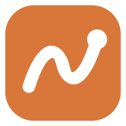
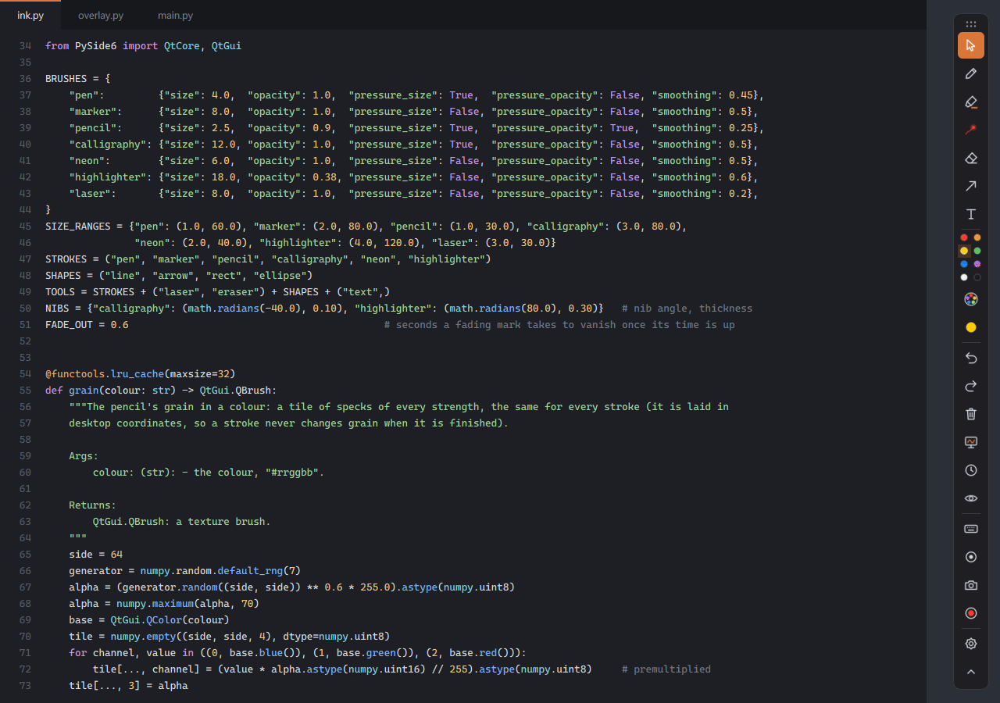
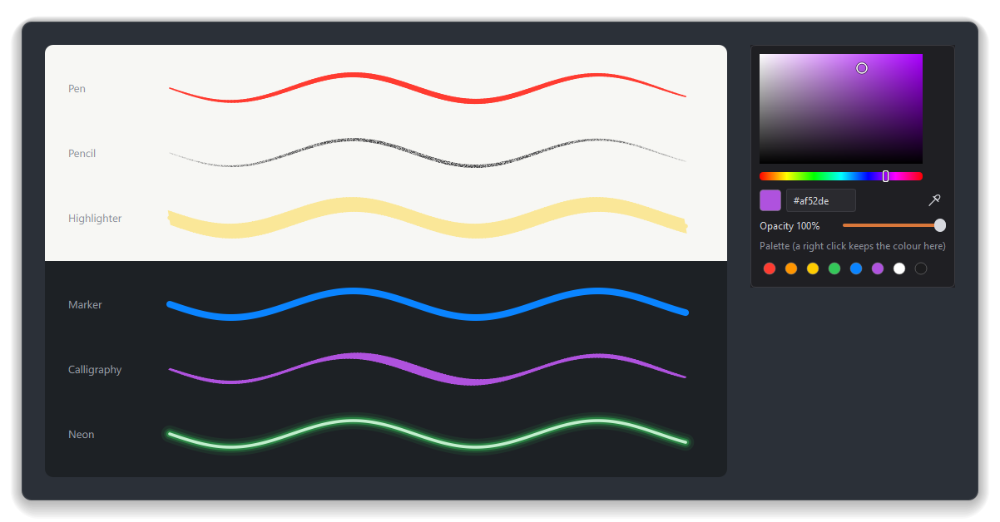
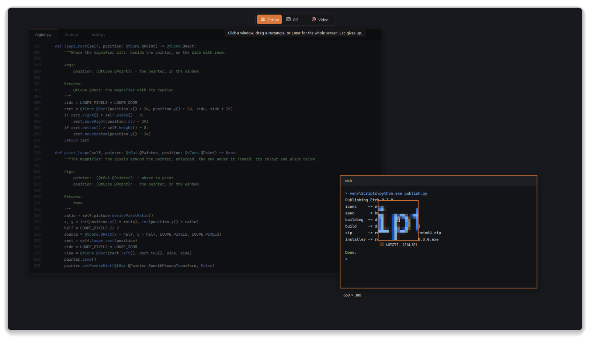
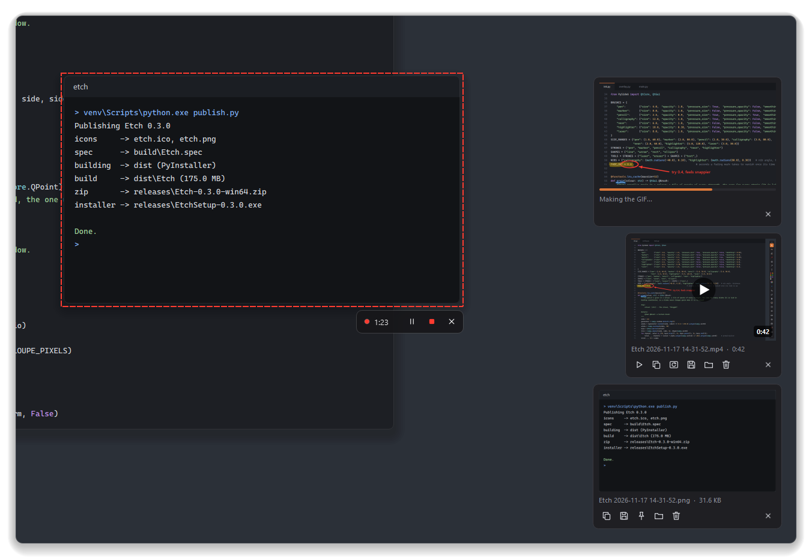
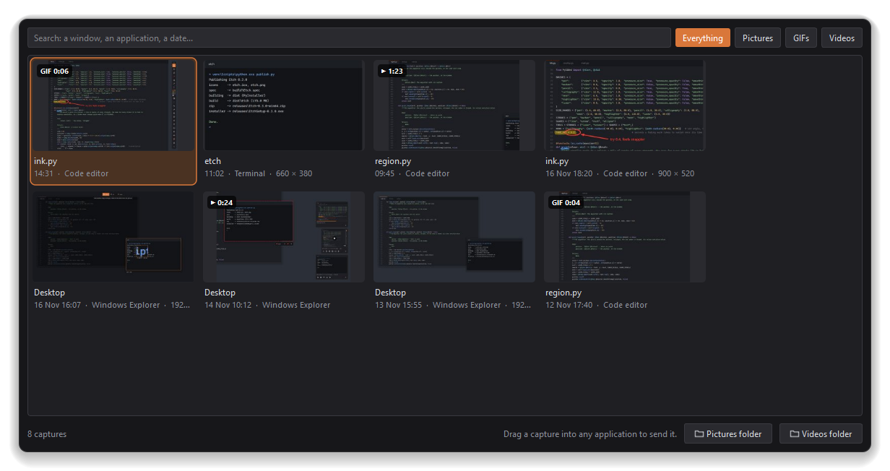
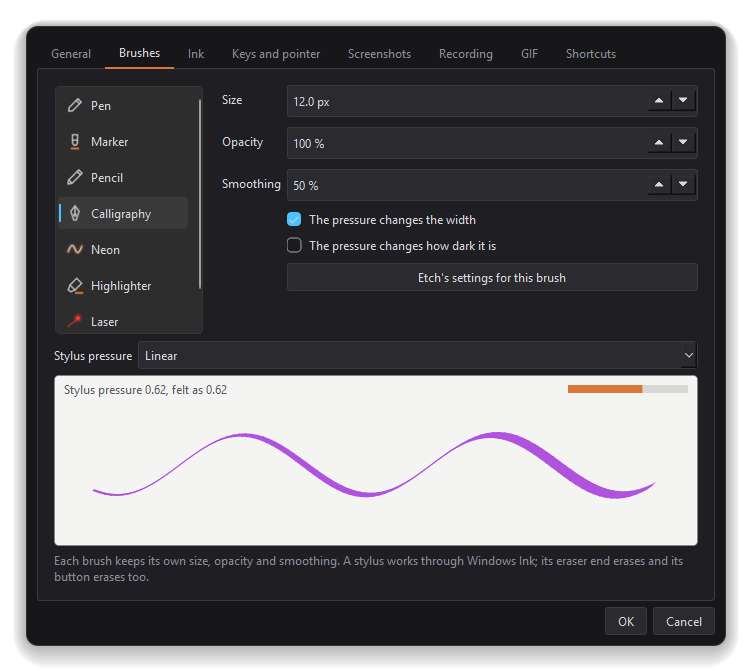

# Etch

**Draw on the screen. Capture it. Drop it anywhere.**

[**Download for Windows**](../../releases/latest) &nbsp;·&nbsp; [Releases](../../releases) &nbsp;·&nbsp; [Roadmap](ROADMAP.md)

 

Etch waits in the tray. Press `Ctrl+Alt+D` and draw over anything on the screen; press it again and the mouse goes
back to the applications while the ink stays. When a picture, a GIF or a video of it is needed, the same keys capture
it and hand it over as a card that drags straight into a chat, a mail or a folder.

## Draw

- **Seven brushes:** pen, marker, pencil, calligraphy, neon, highlighter and a laser pointer that fades at once. A
  stylus's pressure changes the width or the darkness.
- **Shapes, arrows and text,** `Shift` keeps them straight, square or round.
- **Whiteboard and blackboard** with their own ink, one undo history across every screen, ink that can fade by itself.
- **Keys and clicks on screen:** the shortcuts pressed (or everything typed) in large labels, a halo around the
  pointer, rings on clicks. Made for tutorials, demos and calls.
- **Out of the way:** when nothing is drawn the glass leaves the screen entirely, so a game stays full screen.

## Capture

The screens freeze first, so a menu or a tooltip stays exactly as it was. Then click a window, drag a rectangle, or
press `Enter` for the whole screen; a magnifier shows the pixels under the pointer.

| | |
|---|---|
| **Picture** `Win+Shift+S` | PNG or JPG in `Pictures\Etch`, copied to the clipboard at once |
| **GIF** `Ctrl+Alt+G` | Records at once, up to 15 seconds, one palette for the whole clip so it never flickers |
| **Video** `Ctrl+Alt+Shift+R` | MP4 up to 60 frames a second, with the computer's sound and the microphone when ticked |

The toolbar, the recording bar and the frame around a rectangle never show in a capture.

## Share

Every capture lands as a card in the corner of the screen. **Drag the card into any application** and the file goes
there; copy it, pin a picture above everything, turn a video into a GIF, or send it to the Recycle Bin.

**Captures** keeps every one of them with the window and the application it came from: search by window,
application, date or kind, and drag several out at once.

## Install

1. Download `EtchSetup-<version>.exe` from the [latest release](../../releases/latest) and run it. It installs for
   your account, no administrator needed.
2. Windows may say *Windows protected your PC*: click **More info**, then **Run anyway** (Etch is not signed yet).
3. Etch starts in the tray with its toolbar on the right. `Ctrl+Alt+D` draws.

A portable `Etch-<version>-win64.zip` is attached to every release too: unzip it anywhere and run `Etch.exe`.

**Updates.** Etch looks for a new version by itself every few hours and says so from the tray; **Check for updates**
is in the tray menu and in *Settings > General*. A new version downloads, checks it is the one published, installs
over the old one and starts again, settings kept.

Windows 10 version 2004 or later, Windows 11, 64-bit. Settings, log and history live in `%APPDATA%\Etch`.

<b>Every shortcut</b>

 

| Shortcut | What it does |
|---|---|
| `Ctrl+Alt+D` | Draw, or give the mouse back (the ink stays) |
| `Esc` | Stop drawing |
| `Ctrl+Alt+X` | Clear the ink (`Ctrl+Z` brings it back) |
| `Ctrl+Alt+H` | Show or hide the ink |
| `Ctrl+Alt+W` | Whiteboard, blackboard, then the screen again |
| `Win+Shift+S` | Capture a picture (Etch takes it over from Windows' own screen snip) |
| `Ctrl+Alt+G` | Capture a GIF, or stop it |
| `Ctrl+Alt+Shift+R` | Capture a video, or stop it |
| `Ctrl+Alt+K` | Show the keys typed, or not |
| `Ctrl+Alt+T` | Show or hide the toolbar |

While drawing: `P` pen, `M` marker, `G` pencil, `C` calligraphy, `N` neon, `H` highlighter, `S` laser, `E` eraser,
`L` line, `A` arrow, `R` rectangle, `O` ellipse, `T` text, `B` board, `1` to `8` colours, `[` `]` or the wheel for
the size, `Ctrl+Z` / `Ctrl+Y` undo and redo. Every shortcut can be changed in the settings.

<b>Settings</b>

 

Each brush keeps its own size, opacity and smoothing; a pad tries them with the stylus's pressure shown as it presses.

---

(c) 2026 Gregoire Dehame. All rights reserved.

